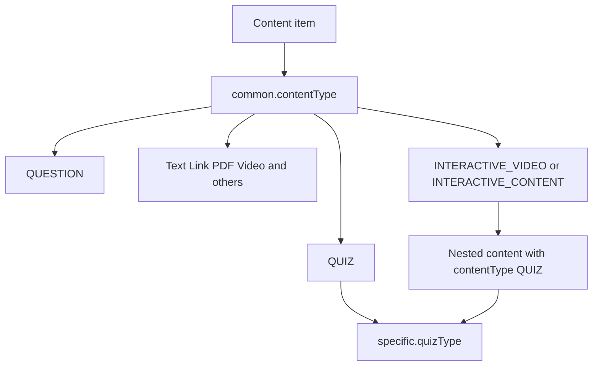

# Content types and quizzes

A course content item is always two parts: `common` and `specific`. `common.contentType` chooses the block. A course quiz is one of those blocks. It is not a separate object.

Source of the stored values: `src/models/Content.ts`, `src/utils/ContentDefaultValues.ts`, and `src/utils/Formatter.ts` (`getQuizPayloadBasedOnType`).

## How a content item becomes a quiz

Set both of these for a course quiz:

| Field | Stored value |
| --- | --- |
| `common.contentType` | `QUIZ` |
| `specific.quizType` | One of the nine quiz types below |

`quizType` is ignored unless `contentType` is `QUIZ`. The default quiz type on a new quiz block is `matching`.

A quiz can stand alone, or it can be nested inside a host:

- `INTERACTIVE_CONTENT` stores overlays in `specific.contentList`.
- `INTERACTIVE_VIDEO` stores one video per language in `specific.interactiveVideoByLanguage`. Each language video has its own `contentList`.

Each overlay item is:

| Field | Type | Meaning |
| --- | --- | --- |
| `contentType` | `ContentTypes` | Type of the nested block. `QUIZ` when the overlay is a quiz. |
| `time` | string | When the overlay appears. `HH:MM:SS` style, converted with `timeToSeconds`. |
| `canSkip` | boolean | Learner can skip the overlay. |
| `isDefault` | boolean | Included as a default sub-content. |
| `contentBody` | full content item | `common` plus `specific`. For a quiz, `contentBody.common.contentType` is `QUIZ` and `contentBody.specific.quizType` is the quiz type. |

Time rules:

- On `INTERACTIVE_VIDEO`, `time` cannot be later than that language video's `videoLength`, and two overlays cannot share the same `time`.
- On `INTERACTIVE_CONTENT`, `time` cannot be `0`.

Nested blocks cannot be `INTERACTIVE_VIDEO`, `INTERACTIVE_CONTENT`, `QUESTION`, or `none`. An interactive video also cannot nest `VIDEO` or `ANIMATION`. A nested quiz is allowed in both hosts. `VIDEO` and `ANIMATION` are not quizzes. They become a place to show a quiz only when the block is an `INTERACTIVE_VIDEO`.

### Three things that look like quizzes

| What | Where it lives | What it is |
| --- | --- | --- |
| Course quiz | `contentType` `QUIZ` and `specific.quizType` | Matching, ordering, liker, picture, scenario, hot spot, or one of the three interactive modules. |
| Question block | `contentType` `QUESTION` | One question with options. It is not a `quizType`. It cannot be nested in interactive video or interactive content. |
| Exam-library question | `src/models/Exam.ts`, not a content block | `questionType` is `SINGLE_CHOICE`, `MULTIPLE_CHOICE`, `TRUE_FALSE`, or `YES_NO`. Status is `ACTIVE` or `INACTIVE`. This is separate from course `QUIZ` blocks. |

`AllContentTypes` is `ContentTypes | QuizTypes`. Player switches sometimes match on `quizType` directly when the block is a quiz.

The three interactive quiz types use the same stored strings as `InteractiveModuleId` in `src/features/content/interactive-modules/types.ts`: `password_compliance`, `ransomware_simulator`, `phishing_detection`.

## Shared fields

### `common`

| Field | Values |
| --- | --- |
| `contentName` | Required string. |
| `description` | Optional string. |
| `contentType` | One `ContentTypes` value. See the table below. |
| `status` | `DRAFT` or `PUBLISHED`. |
| `author` | Optional string. |
| `chapterIds` | Optional list of chapter ids. |
| `tags` | Optional list of strings. |

### Background

Present on every block that extends background formatting, including quizzes.

| Field | Values |
| --- | --- |
| `textColor` | CSS color. Default `#000000`. |
| `backgroundColor` | CSS color. Default `#ffffff00`. |
| `backgroundImage` | Image path. Empty when unset. |
| `backgroundOpacity` | Number on the model. The settings form keeps it as a string. Default `100`. |
| `tone` | `DARK` or `LIGHT`. Default `LIGHT`. |

### Text formatting

Used by text, link, PDF, slider show, tabbed, and each slide.

| Group | Fields |
| --- | --- |
| `titleFormatting` | `title`, `titleColor` (default `#ffffff`), `titleHighContrastMode` (boolean) |
| `subTitleFormatting` | `subtitle`, `subtitleColor` (default `#ffffff`), `subtitleHighContrastMode` (boolean) |
| `paragraphFormatting` | `paragraph`, `paragraphColor` (default `#ffffff`), `paragraphHighContrastMode` (boolean) |

## Content types

Stored value is what the API keeps. The TypeScript name differs for two types: slider show is stored as `SLIDE`, tabbed as `TAB`. `NONE` is stored as `none` and is not an authoring option.

| Authoring label | TypeScript name | Stored `contentType` |
| --- | --- | --- |
| Text/Web-based | `TEXT` | `TEXT` |
| Link | `LINK` | `LINK` |
| PDF | `PDF` | `PDF` |
| Question | `QUESTION` | `QUESTION` |
| Slider show | `SLIDER_SHOW` | `SLIDE` |
| Tabbed | `TABBED` | `TAB` |
| Video | `VIDEO` | `VIDEO` |
| Animation | `ANIMATION` | `ANIMATION` |
| Mark down | `MARKDOWN` | `MARKDOWN` |
| Story Blocks | `STORY_BLOCK` | `STORY_BLOCK` |
| Slider Level | `SLIDER_LEVEL` | `SLIDER_LEVEL` |
| Quiz | `QUIZ` | `QUIZ` |
| Interactive Video | `INTERACTIVE_VIDEO` | `INTERACTIVE_VIDEO` |
| Interactive Content | `INTERACTIVE_CONTENT` | `INTERACTIVE_CONTENT` |
| — | `NONE` | `none` |

### Text (`TEXT`)

Text formatting, background, and `featureImageLink`.

### Link (`LINK`)

Everything on text, plus `linkFormatting`:

| Field | Values |
| --- | --- |
| `linkText` | String. |
| `url` | String. |
| `linkColor` | CSS color. Default `#ffffff`. |

### PDF (`PDF`)

Everything on text, plus `metadata.additionalProp1`:

| Field | Values |
| --- | --- |
| `pdfText` | String. |
| `pdfLink` | File path. |
| `pdfTextColor` | CSS color. Default `#ffffff`. |
| `pdfIsRequired` | Boolean. Default `false`. |

`pdfFileName` and `pdfFileURL` are also on the PDF payload.

### Question (`QUESTION`)

This is the single-question content block, not a course quiz.

| Field | Values |
| --- | --- |
| `question` | String. |
| `scorable` | Boolean. Default `false`. |
| `score` | `EASY`, `MEDIUM`, or `HARD`. Required when `scorable` is true. Empty when it is not. |
| `options` | List of `{ id?, option, isCorrect }`. `isCorrect` is boolean. |

### Slider show (`SLIDE`)

Text formatting, background, `featureImageLink`, a `slides` list, and `slideAdditionalProperties`.

Each slide: text formatting, `featureImageLink`.

Button fields: `buttonText`, `buttonTextColor` (default `#ffffff`), `buttonColor` (default `#37BE99`), `buttonHoverColor` (default `#37BE99`).

### Tabbed (`TAB`)

Text formatting and background, plus `tabSections` and `additionalProperties`.

| Field | Values |
| --- | --- |
| `tabbedPosition` | `COLUMN` (default) or `ROW`. |
| `buttonTextColor` | CSS color. Default `#ffffff`. |
| `buttonColor` | CSS color. Default `#ffffff00`. |
| `buttonHoverColor` | CSS color. Default `#ffffff00`. |
| `audioUrl` | Shared audio path. |

Each tab (`additionalProperties` on a section): `paragraph`, `navigationButtonText`, `displayTime` (default `00:00`), `audioUrl`.

### Markdown (`MARKDOWN`)

Background, plus `markdownText`, `headingColor`, `textColor`, `linkColor`. Color defaults are `#ffffff`.

### Story block (`STORY_BLOCK`)

Background and a list of steps. Each step has stories.

Step fields: `title`, `titleColor`, `featureImage`, `openPopup`, popup text and button colors, `description`, `descriptionColor`, `advisorInstructionText`, `advisorInstructionTextColor`.

Each story:

| Field | Values |
| --- | --- |
| `correctSituation` | `AGREE` (default) or `IGNORE`. |
| `agreeText`, `ignoreText` | Strings, each with a color. |
| `actionButtonTitle` | String, plus button colors. Default button color `#37BE99`. |
| `description`, `featureImage` | String and image path. |

`openPopup` is boolean. Default `false`.

### Slider level (`SLIDER_LEVEL`)

Background and a list of steps. Each step has buttons.

Step fields match the story step, plus `navigationButtonText` and its colors.

Each button:

| Field | Values |
| --- | --- |
| `correctAcceptanceText` | `ACCEPTABLE` (default), `WARNING`, or `UNACCEPTABLE`. |
| `acceptanceText` | String, plus `acceptanceTextColor`. |
| `navigationButtonText` | String, plus text, fill, and hover colors. |
| `openPopup` | Boolean. Default `false`. |
| Popup fields | `popupText`, `popupButtonText`, and their colors. |

### Video (`VIDEO`) and animation (`ANIMATION`)

Both use the same payload. Animation is a separate `contentType` so the library can tell them apart. Neither has a `quizType`.

| Field | Values |
| --- | --- |
| `interactiveVideo.videoUrl` | Uploaded video path. |
| `interactiveVideo.videoFile` | File while uploading. Not a stored setting. |
| `interactiveVideo.isProcessing` | Boolean. |
| `interactiveVideo.processingStatus` | `QUEUE`, `PROCESSING`, or `PROCESSED`. Empty string on a brand-new video before a status is set. |
| `interactiveVideo.processVideoUrl` | Processed file path. |
| `captionUrl` | Caption file path. |
| `videoLength` | Optional duration string. |
| `metadata.additionalProp1.videoText` | Title text. |

`IntervalType` (`START`, `CLEAR`) is only the player poll control while a video is processing. It is not saved on the content item.

### Interactive video (`INTERACTIVE_VIDEO`)

Background, plus `interactiveVideoByLanguage`. Languages come from the languages API (`id`, `code`, `displayName`). `language` stores that choice. It is not a fixed enum in this module.

Each language card:

| Field | Values |
| --- | --- |
| `cardTitle` | String. Default `Video Card`. |
| `language` | Language code or id from the languages API. |
| `default` | Boolean. The card with `default: true` is the primary video. If none is marked, the first card is used. |
| `videoUrl`, `videoLength` | Path and duration. |
| `isProcessing` | Boolean. |
| `processingStatus` | `QUEUE` (default on a new card), `PROCESSING`, or `PROCESSED`. |
| `processVideoUrl` | Processed file path. |
| `contentList` | Timed overlays. A quiz overlay uses `contentType` `QUIZ`. |

### Interactive content (`INTERACTIVE_CONTENT`)

Background and `contentList`. Same overlay shape as a language video. This host has no video file of its own. A quiz in the list is still a full `QUIZ` body with its own `quizType`.

## Quiz types

Authoring labels come from the quiz settings selector. The stored value is `specific.quizType`. Every quiz also keeps the shared background fields. The formatter saves only the fields listed for that type.

| Authoring label | Stored `quizType` |
| --- | --- |
| Matching | `matching` |
| Ordering/Sequencing Answer | `ordering` |
| Liker Scale Question | `liker` |
| Picture Choice | `picture` |
| Scenario-based/Case Study | `scenario` |
| Hot spot Quiz | `hot_spot` |
| Ransomware Simulator Quiz | `ransomware_simulator` |
| Password Compliance Quiz | `password_compliance` |
| Phishing Detection Quiz | `phishing_detection` |

### Matching (`matching`)

| Field | Values |
| --- | --- |
| `question` | String. |
| `labelLeft`, `labelRight` | Column headings. |
| `pairs` | List of pairs. At least the two sides of each pair. |

Each pair:

| Field | Values |
| --- | --- |
| `inputTypeLeft`, `inputTypeRight` | `text` or `image`. Default `text`. |
| `valueLeft`, `valueRight` | Text when that side is `text`. |
| `linkLeft`, `linkRight` | Image path when that side is `image`. |
| `fileLeft`, `fileRight` | File while uploading. |

A side can be text on one column and image on the other.

### Ordering (`ordering`)

The correct answer is the option order. `index` is that order. `isCorrect` is not saved.

| Field | Values |
| --- | --- |
| `question` | Required string. |
| `options` | Ordered list. |

Each option: `id`, `index`, `optionText`, `optionImage`, `optionImageLink`. An option is either text or an image.

### Liker scale (`liker`)

Same saved option shape as ordering: `question` and `options`, no `isCorrect`. The scale is five fixed slots. Label text can be edited. `optionImageLink` selects the icon and should stay one of:

| Default label | `optionImageLink` |
| --- | --- |
| Strongly Disagree | `strongly-disagree` |
| Somewhat Disagree | `somewhat-disagree` |
| Neither Disagree or Agree | `neither-disagree-agree` |
| Somewhat Agree | `somewhat-agree` |
| Strongly Agree | `strongly-agree` |

`question` is required. Each `optionText` is required.

### Picture choice (`picture`)

| Field | Values |
| --- | --- |
| `question` | Required string. |
| `options` | Image choices. |

Each option: `id`, `index`, `optionText` (usually empty; the picture is the choice), `optionImage`, `optionImageLink`, `isCorrect` (boolean). One or more options can be marked correct.

### Scenario (`scenario`)

| Field | Values |
| --- | --- |
| `scenarioText` | Required HTML string from the text editor. |
| `questions` | List of questions under that scenario. |

Each question: `id`, `question`, and `options`. Each option is `{ id?, option, isCorrect }`. `option` is the label. `isCorrect` is boolean. This option shape matches the question block, not the picture or ordering option shape.

### Hot spot (`hot_spot`)

| Field | Values |
| --- | --- |
| `imageLink` | Image path. |
| `imageFile` | File while uploading. Replacing the image clears annotations and correct tags. |
| `imageTitle` | Required string. |
| `annotations` | List of image annotations. Drawing tool is `rectangle` or `polygon`. |
| `correctTags` | Annotation ids that are the correct regions. Required to have at least one. |
| `correctFeedback` | Required string. |
| `incorrectFeedback` | Required string. |
| `showAutoFeedback` | Boolean. Default `false`. |

An annotation has `id`, `target.annotation`, `target.selector`, and `bodies`. A body can include `id`, `annotation`, `type`, `purpose`, and `value`. Tag text uses `purpose` `tagging`.

### Ransomware simulator (`ransomware_simulator`)

| Field | Values |
| --- | --- |
| `question` | Optional instructions, shown as the subtitle. |

No pairs, options, emails, or score. The learner runs the ransomware simulator module. `InteractiveModuleId.RANSOMWARE_SIMULATOR` is the same string.

### Password compliance (`password_compliance`)

| Field | Values |
| --- | --- |
| `question` | Optional instructions, shown as the subtitle. |

No other quiz fields. The learner runs the password compliance checker. `InteractiveModuleId.PASSWORD_COMPLIANCE` is the same string.

### Phishing detection (`phishing_detection`)

| Field | Values |
| --- | --- |
| `question` | Optional string. |
| `timeLimitSeconds` | Number. Default `180`. Minimum `10`. |
| `emails` | List of mailbox messages. At least one is expected by the settings form. |

Each email:

| Field | Values |
| --- | --- |
| `senderName` | String. |
| `senderEmail` | Email address. |
| `subject` | String. |
| `date` | String. |
| `time` | String. |
| `avatar` | Optional string. |
| `body` | HTML string. |
| `isPhishing` | Boolean. Default `true` on a new email. |
| `explanation` | Optional string shown after the learner answers. |
| `links` | List of links in the body. |

Each link: `label` (optional), `displayText`, `actualUrl`.

`InteractiveModuleId.PHISHING_DETECTION` is the same string as this `quizType`.
